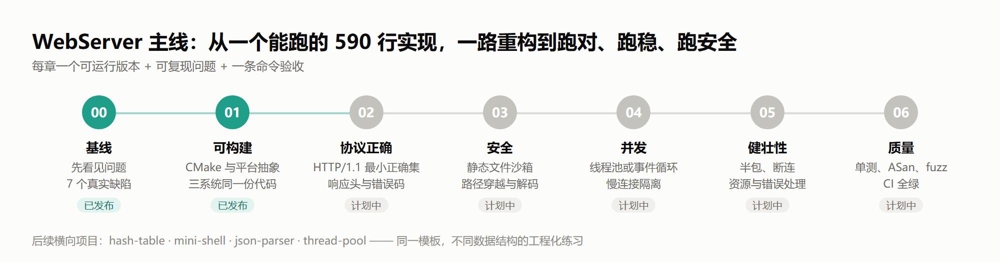

<div align="center">

# C Lab · 从能跑到跑对

**以真实项目为教材的 C 语言学习仓库：从一份有 7 个缺陷的 590 行 HTTP 服务器出发，逐章重构成跑对、跑稳、跑安全的实现**


[学习路线](#学习路线) · [快速开始](#快速开始) · [章节结构](#每一章的固定结构) · [仓库结构](#仓库结构) · [参与贡献](#参与贡献)



</div>

---

一个以**真实项目**为教材的 C 语言学习仓库：不直接给「正确代码」，而是从一份有缺陷的真实实现出发，逐章重构，每一章都有可运行版本、可复现的问题和自动化验收。

> 定位：系统编程与工程能力的练习场，不是生产级组件库。所有代码用于学习，未做生产环境的安全审计。

## 为什么做这个仓库

大多数 C 教程给你一段能跑的代码；真实工作里更常见的是接手一段**能跑但有隐患**的代码。判断它哪里会崩、为什么会崩、按什么顺序修，比从零写更难，也更接近工程现场。

本仓库的第一条主线是 [`WebServer1.0`](projects/01-webserver/README.md)——一个 590 行、单线程、Windows-only 的 HTTP 服务器。它 socket 生命周期完整、模块划分清楚，同时带着 7 个可触发的严重缺陷（崩溃、路径穿越、空转、协议错误），以及一批不规范的响应头。我们把它拆成 7 个阶段，从「跑起来」一路重构到「跑对、跑稳、跑安全、可测试」。

## 学习路线

| 章节 | 主题 | 你会得到什么 | 状态 |
| --- | --- | --- | --- |
| 00 | 基线：先看见问题 | 7 个真实缺陷的复现方法与根因分析 | ✅ 已发布 |
| 01 | 可构建：CMake + 跨平台 socket 抽象 | Linux / Windows / macOS 同一份代码可编译 | ✅ 已发布 |
| 02 | 协议正确：HTTP/1.1 最小正确集 | 严格解析请求、正确的响应头与错误码 | 🚧 计划中 |
| 03 | 安全：静态文件服务沙箱 | 路径穿越、URL 解码、请求上限与超时 | 🚧 计划中 |
| 04 | 并发：线程池或事件循环 | 慢连接隔离、连接上限、优雅退出 | 🚧 计划中 |
| 05 | 健壮性：资源与错误处理 | 断连、半包、部分发送、日志与配置 | 🚧 计划中 |
| 06 | 质量：测试与工具链 | 单元 / 集成测试、ASan、UBSan、fuzz、CI | 🚧 计划中 |

后续横向项目（每个都按同一模板建设）：

| 项目 | 难度 | 教学点 | 状态 |
| --- | --- | --- | --- |
| 02-hash-table | 入门 | 内存管理、开链 / 开放寻址、单元测试 | 计划中 |
| 03-mini-shell | 进阶 | fork/exec、管道、重定向、信号 | 计划中 |
| 04-json-parser | 进阶 | 递归下降、内存所有权、fuzz | 计划中 |
| 05-thread-pool | 进阶 | pthread、条件变量、TSan | 计划中 |

## 仓库结构

```
c-lab/
├── projects/
│   └── 01-webserver/          第一条主线：从 590 行教学服务器重构
│       ├── docs/              每章讲义
│       ├── stages/            每一章一个可运行的完整版本
│       └── tests/             复现脚本与集成测试
├── common/                    跨项目共用：日志、测试脚手架、平台抽象
├── cmake/                     警告、Sanitizer、工具链配置
├── docs/                      ROADMAP 与通用讲义
├── scripts/                   一键构建、检查、环境配置
└── .github/workflows/         Linux / Windows / macOS CI
```

## 快速开始

### 环境

任选其一：

- **WSL2 + Ubuntu**（推荐，Linux 下 ASan、valgrind、fuzz 都可用）
- **MSYS2 + MinGW-w64**（Windows 原生）
- **Linux / macOS**：`build-essential` 或 Xcode Command Line Tools

本仓库构建使用 CMake ≥ 3.20 与 C11。没有 CMake 时，各章也提供直接 `gcc` 的构建命令。

```bash
cmake -S . -B build -DCLAB_ENABLE_SANITIZERS=ON
cmake --build build
ctest --test-dir build --output-on-failure
```

### 从第一章开始

```bash
cd projects/01-webserver
cat docs/00-baseline.md          # 讲义：先读，再动手
cd stages/00-baseline            # 原项目（UTF-8 转码，逻辑未改）
```

基线是 Windows 程序，编译与运行方式见 `stages/00-baseline/README.md`。复现脚本在 `projects/01-webserver/tests/`。

## 每一章的固定结构

1. **目标**：这一章结束后你能做到什么。
2. **上一版的问题**：为什么现在的实现不对，怎么复现。
3. **改动**：只讲这一章需要的改动，附 diff 要点。
4. **验收**：一条命令跑通测试与检查。
5. **练习**：2～4 道，难度递增，答案在章末折叠。
6. **延伸阅读**：标准、论文、书。

## 参与贡献

欢迎提交 Issue 与 Pull Request。新增项目的质量标准、章节模板与提交规范见 [CONTRIBUTING.md](CONTRIBUTING.md)。

## 许可证

- 代码：[MIT](LICENSE)
- 讲义与文档：[CC BY 4.0](https://creativecommons.org/licenses/by/4.0/deed.zh)

第三方素材与出处见 [THIRD_PARTY_NOTICES.md](THIRD_PARTY_NOTICES.md)。
